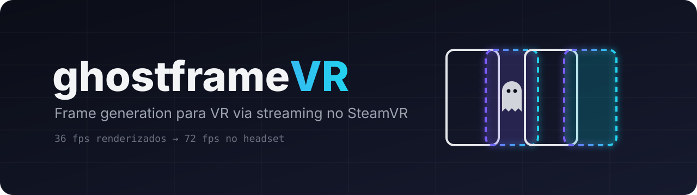
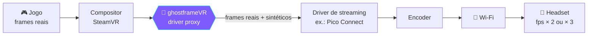

<p align="center">
  
</p>

<p align="center">
  <a href="https://github.com/luizhc06/ghostframevr/actions/workflows/ci.yml"></a>
  <a href="https://github.com/luizhc06/ghostframevr/releases"></a>
  
  
  <a href="LICENSE"></a>
</p>

<p align="center">
  <b>Frame generation para headsets VR que fazem streaming pelo SteamVR, sem tocar no jogo.</b><br>
  Dobra ou triplica o fps dos jogos em VR, tirando trabalho da CPU e passando para a GPU.
</p>

<p align="center">
  <a href="#-como-funciona">Como funciona</a> •
  <a href="#-roadmap">Roadmap</a> •
  <a href="#-instalação">Instalação</a> •
  <a href="#-lendo-o-log">Lendo o log</a> •
  <a href="#-faq">FAQ</a> •
  <a href="CONTRIBUTING.md">Contribuir</a>
</p>

---

> [!WARNING]
> **Projeto em fase alpha / experimental.** A versão atual (`v0.1`) é um **proxy de diagnóstico**: ela ainda **não gera frames**, só observa e registra como o vídeo passa pelo driver. Use por sua conta e risco e sempre faça backup.

## 👻 Por que

Jogos sociais em VR (mundos cheios, dezenas de avatares) derrubam o fps, quase sempre por **gargalo de CPU**. Upscalers como DLSS/FSR não ajudam (aliviam a GPU, não a CPU) e mods dentro do jogo são bloqueados por anti-cheat.

A ideia do ghostframeVR é mudar onde o trabalho acontece: o jogo entrega menos frames reais, no ritmo que a CPU aguenta, e a GPU, que nesses jogos costuma ter folga, gera os frames que faltam. O ganho (2× ou 3×) depende do seu PC e do headset.

Headsets nativos resolvem isso com reprojeção (ASW, Motion Smoothing). Em **streaming via Wi-Fi**, essa camada é limitada ou inexistente. O ghostframeVR quer preencher esse buraco **fora do processo do jogo**.

## ⚙️ Como funciona



1. O SteamVR carrega drivers como DLLs. O ghostframeVR se coloca **no lugar da DLL do driver de streaming** e carrega a original por trás.
2. Todas as chamadas são repassadas, e o driver original continua funcionando normalmente.
3. Como cada frame passa por nós, podemos (fases futuras) **gerar frames na GPU por extrapolação**: optical flow acelerado por hardware mais correção pela pose atual da cabeça.

Tudo roda dentro do `vrserver.exe` do SteamVR. **O processo do jogo nunca é tocado.**

> Por que extrapolar e não interpolar como o Lossless Scaling? Interpolação precisa esperar o próximo frame → +latência → enjoo em VR. Extrapolação usa só frames passados + a pose mais recente.

## 🗺️ Roadmap

| | Fase | Descrição |
|:-:|---|---|
| ✅ | **1. Diagnóstico** | Proxy transparente que loga caminho de vídeo, taxa de frames, texturas, depth, poses e flags de Motion Smoothing |
| 🔄 | **2. Engenharia reversa** | Entender o `Present` → encode → envio do driver ([briefing](docs/RE_BRIEF.md)) |
| ⏳ | **3. Captura** | Capturar frames D3D11 + poses e gravar para testes offline |
| ⏳ | **4. Frame gen offline** | Protótipo de extrapolação com NVIDIA Optical Flow em frames gravados |
| ⏳ | **5. Injeção** | Inserir frames sintéticos ao vivo quando o jogo perde o vsync |

Acompanhe em [Issues](https://github.com/luizhc06/ghostframevr/issues) e [Milestones](https://github.com/luizhc06/ghostframevr/milestones).

### Compatibilidade

Funciona com qualquer headset cujo lado do PC seja um **driver do SteamVR** e com qualquer jogo que rode **pelo SteamVR** (OpenVR ou OpenXR do SteamVR). O app detecta os drivers sozinho.

| Driver | Status |
|---|---|
| Pico Connect (Pico 4) | 🎯 alvo principal, em teste |
| ALVR, Steam Link, Meta Link / Air Link via SteamVR | 🤷 o proxy é genérico, mas o frame gen precisa ser validado em cada driver. [Mande um relatório](https://github.com/luizhc06/ghostframevr/issues/new?template=test_report.yml) |
| Index / Vive, Windows MR | ➖ sem ganho: já têm reprojeção própria no SteamVR |
| Jogos no runtime Oculus/Meta ou VDXR (fora do SteamVR) | ❌ não passam pelo SteamVR |

Drivers que vêm dentro da pasta do SteamVR (Steam Link, Meta Link) são restaurados quando o SteamVR atualiza. O app avisa e reinstala.

## 📦 Instalação

> [!IMPORTANT]
> Feche o **SteamVR** e o app de streaming antes de começar.

### Pelo app (recomendado)

1. Baixe o `ghostframeVR-<versão>.exe` da [última release](https://github.com/luizhc06/ghostframevr/releases) e abra. Não precisa instalar nada: a DLL do proxy vai embutida no `.exe`.
2. Na aba **Instalação**, confira se o alvo detectado é o driver do seu headset (ex.: Pico Connect) e clique em **INSTALAR**. Se o driver estiver em `Program Files`, o Windows pede permissão de administrador. Antes de trocar qualquer arquivo, o app faz backup em `%LOCALAPPDATA%\ghostframeVR\backup`.
3. Abra o Pico Connect e o SteamVR. A aba **Painel** mostra se o headset está conectado, o fps que chega nele e os gráficos de frame time.
4. Para mandar um teste, use **GERAR RELATÓRIO** e anexe a pasta numa issue.

As opções de frame gen ficam em `%LOCALAPPDATA%\ghostframeVR\ghostframe.ini`. A DLL ainda não lê esse arquivo: ele passa a valer quando o frame gen chegar.

### Manual

1. Baixe o `.zip` da [última release](https://github.com/luizhc06/ghostframevr/releases) e extraia.
2. **Ache a pasta do driver.** Abra `%LOCALAPPDATA%\openvr\openvrpaths.vrpath` no Bloco de Notas; em `external_drivers` está a pasta do driver de streaming. A DLL fica em `bin\win64\driver_<nome>.dll`.
   <sub>Alternativa: `Steam\logs\vrserver.txt` lista o caminho de cada driver carregado.</sub>
3. **Faça backup** da pasta `bin\win64` inteira.
4. Renomeie a DLL original: `driver_<nome>.dll` → `driver_<nome>_real.dll`.
5. Renomeie a `driver_ghostframe.dll` da release para `driver_<nome>.dll` e copie para a mesma pasta.
6. Abra o app de streaming, conecte e abra o SteamVR. Jogue 2–3 minutos.
7. O log fica em `bin\win64\ghostframe.log` (se a pasta não for gravável, ex.: `Program Files`, vai para `%TEMP%\ghostframe.log`).

### Desinstalar

Apague a nossa DLL e renomeie `driver_<nome>_real.dll` de volta para o nome original. Atualizações do app de streaming normalmente desfazem a instalação sozinhas.

## 🔍 Lendo o log

| Linha | Significado |
|---|---|
| `GetComponent("IVRVirtualDisplay_002") -> IMPLEMENTADO` | O driver usa o caminho *VirtualDisplay* (típico de streaming) |
| `GetComponent("IVRDriverDirectModeComponent_009") -> IMPLEMENTADO` | O driver usa o caminho *DirectMode* |
| `STATS ... Present  <n>/s` | Frames por segundo saindo para o headset |
| `SubmitLayer ... depth=0x...` | Depth ≠ `0x0` → o jogo envia profundidade (frame gen bem melhor) |
| `GetFrameTiming ... motionSmoothing=on` | SteamVR acha que o Motion Smoothing está ativo |
| `!! versão diferente` | Interface desconhecida: o proxy entra em modo passthrough puro |

Achou algo? [Abra um relatório de teste](https://github.com/luizhc06/ghostframevr/issues/new?template=test_report.yml) com o log anexado. 🙏

## 🛠️ Compilando

**Windows (Visual Studio 2022 + CMake):**

```powershell
cmake -S . -B build -A x64
cmake --build build --config Release
```

**Linux → Windows (MinGW-w64):**

```bash
cmake -S . -B build-win -DCMAKE_TOOLCHAIN_FILE=cmake/mingw-w64.cmake -DCMAKE_BUILD_TYPE=Release
cmake --build build-win
```

**App de controle** (Windows, Rust + WebView2). A lógica é testada no Linux com `cargo test`. Para ajustar a interface sem compilar, abra `app/ui/index.html` num navegador: ele usa dados simulados.

```powershell
cd app
$env:GF_PROXY_DLL = "..\build\Release\driver_ghostframe.dll"
cargo build --release
```

**Testes** (Linux, simulam SteamVR + driver falso):

```bash
cmake -S . -B build && cmake --build build && ctest --test-dir build --output-on-failure
```

<details>
<summary><b>Estrutura do projeto</b></summary>

```
src/proxy/       driver proxy (HmdDriverFactory + wrappers das interfaces OpenVR)
app/             app de controle (Tauri 2): instala o proxy, status, gráficos, ghostframe.ini
tests/           SteamVR e driver de streaming simulados
docs/            briefing de engenharia reversa, assets
third_party/     openvr_driver.h (Valve, BSD)
cmake/           toolchain MinGW
```
</details>

## ❓ FAQ

<details>
<summary><b>Posso tomar ban em jogo com anti-cheat?</b></summary>

O ghostframeVR não injeta nada no jogo, não lê nem altera sua memória e roda num processo separado (o do SteamVR), do mesmo jeito que qualquer driver de VR. Dito isso, ninguém pode dar garantia absoluta. Use com consciência.
</details>

<details>
<summary><b>Já gera frames?</b></summary>

Ainda não. A `v0.1` é só diagnóstico. A geração de frames vem nas fases 4–5 do roadmap.
</details>

<details>
<summary><b>Por que não usar o Motion Smoothing do SteamVR?</b></summary>

Use, se ele funcionar com o seu headset! Em muitos drivers de streaming ele não ativa. O próprio log do ghostframeVR mostra se está ativo.
</details>

<details>
<summary><b>Funciona com placas AMD?</b></summary>

O proxy (fase 1) funciona com qualquer GPU. O frame gen planejado usa NVIDIA Optical Flow (RTX 20+); um caminho alternativo para AMD/Intel está em aberto.
</details>

## 🤝 Contribuindo

Relatórios de teste com log são a contribuição mais valiosa agora. Veja o [CONTRIBUTING.md](CONTRIBUTING.md).

## ⚖️ Aviso legal

Projeto independente, sem afiliação com Pico/ByteDance, Valve ou qualquer desenvolvedora de jogos. Nomes e marcas pertencem aos seus donos e são citados só para indicar compatibilidade. Não distribua binários de terceiros. A engenharia reversa feita aqui tem fim exclusivo de interoperabilidade.

## 📄 Licença

[MIT](LICENSE) © Luiz Castro. `third_party/openvr/openvr_driver.h` © Valve Corporation, licença BSD-3.
