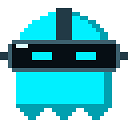
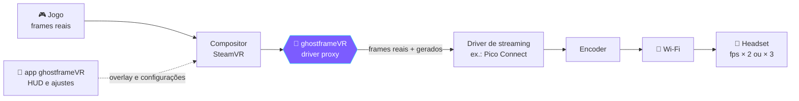
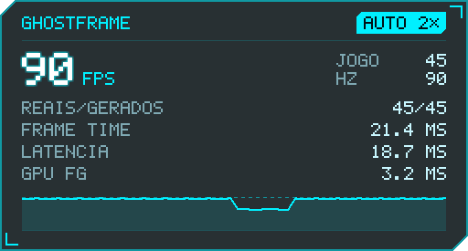

<p align="center">
  
</p>

<p align="center">
  <a href="https://github.com/luizhc06/ghostframevr/actions/workflows/ci.yml"></a>
  <a href="https://github.com/luizhc06/ghostframevr/releases"></a>
  
  
  <a href="LICENSE"></a>
</p>

<p align="center">
  <br>
  <b>Frame generation para headsets VR que fazem streaming pelo SteamVR, sem tocar no jogo.</b><br>
  Dobra ou triplica o fps dos jogos em VR, tirando trabalho da CPU e passando para a GPU.
</p>

<p align="center">
  <a href="#-como-funciona">Como funciona</a> •
  <a href="#-o-app">O app</a> •
  <a href="#-instalação">Instalação</a> •
  <a href="#-roadmap">Roadmap</a> •
  <a href="#-lendo-o-log">Lendo o log</a> •
  <a href="#-faq">FAQ</a> •
  <a href="CONTRIBUTING.md">Contribuir</a>
</p>

---

> [!WARNING]
> **Projeto em fase alpha / experimental.** Desde a `v0.2` o ghostframeVR gera frames, mas ainda não foi testado num headset real. O frame gen vem **desligado**: você liga no app e, se algo falhar, o proxy volta sozinho a só repassar os frames e o log diz o motivo. Use por sua conta e risco.

## 👻 Por que

Jogos sociais em VR (mundos cheios, dezenas de avatares) derrubam o fps, quase sempre por **gargalo de CPU**. Upscalers como DLSS/FSR não ajudam (aliviam a GPU, não a CPU) e mods dentro do jogo são bloqueados por anti-cheat.

A ideia do ghostframeVR é mudar onde o trabalho acontece: o jogo entrega menos frames reais, no ritmo que a CPU aguenta, e a GPU, que nesses jogos costuma ter folga, gera os frames que faltam. O ganho (2× ou 3×) depende do seu PC e do headset.

Headsets ligados por cabo resolvem isso com reprojeção (ASW, Motion Smoothing). Em **streaming via Wi-Fi** essa camada é limitada ou inexistente. O ghostframeVR preenche esse buraco **fora do processo do jogo**.

## ⚙️ Como funciona



1. O SteamVR carrega cada driver como uma DLL. O ghostframeVR entra **no lugar da DLL do driver do seu headset** (Pico Connect, ALVR...) e carrega a original por trás. Tudo é repassado, então o driver continua funcionando normalmente.
2. Com o frame gen ligado, cada frame real do jogo vai para um motor na GPU (D3D11, compute shaders) que mede o movimento entre os dois últimos frames, já descontando o giro da cabeça.
3. Quando o jogo não tem frame novo, o proxy entrega um **frame gerado por extrapolação**: o último frame real deformado para a frente pelo movimento medido. Com a trava de fps do SteamVR (½ ou ⅓), entra um frame gerado em cada vsync entre os reais.
4. O giro da cabeça continua com o timewarp do próprio headset, como sempre. Detalhes em [docs/FRAMEGEN.md](docs/FRAMEGEN.md).

Tudo roda dentro do `vrserver.exe` do SteamVR e no app à parte. **O processo do jogo nunca é tocado.**

> Por que extrapolar e não interpolar como o Lossless Scaling? Interpolação precisa esperar o próximo frame real, o que soma atraso e dá enjoo em VR. Extrapolação usa só frames passados e a posição mais recente da cabeça.

## 🖥️ O app

O `ghostframeVR.exe` instala o proxy, liga o frame gen e mostra o que está acontecendo. Ele roda à parte, ao lado do SteamVR, como o XSOverlay ou o OVR Toolkit.

| Aba | O que faz |
|---|---|
| **Painel** | SteamVR, headset (modelo e Hz), driver e proxy; fps no headset, fps do jogo, **frames gerados**, frame time e gráficos |
| **Desempenho** | Frame gen em **Auto** (escolhe 2× ou 3× pelo que o jogo aguenta) ou **Manual**; ajustes do SteamVR **ao vivo**: resolução, motion smoothing e trava de fps por jogo |
| **HUD** | Relógio no pulso dentro do headset, com âncora, tamanho, opacidade, posição, itens e prévia real |
| **Instalação** | Detecta o driver do headset, instala, atualiza ou desinstala o proxy (com backup) |
| **Log** | O `ghostframe.log` ao vivo e o botão **Gerar relatório** |

<p align="center">
  <br>
  <sub>O HUD como aparece no headset (imagem desenhada pelo próprio app).</sub>
</p>

- **HUD de relógio:** vire o pulso para o rosto e ele aparece; abaixe o braço e ele some.
- **Leve:** fechar a janela deixa o app na bandeja, cuidando do HUD e do modo Auto com poucos MB de RAM.
- **Iniciar com o SteamVR:** opção na aba HUD; daí em diante é só abrir o SteamVR e jogar.
- **Trava segura:** o app só trava o fps do jogo com o frame gen funcionando, e desfaz a trava que ele mesmo pôs se nenhum frame gerado chegar ao headset, mesmo depois de reiniciar.

## 📦 Instalação

> [!IMPORTANT]
> Feche o **SteamVR** antes de instalar ou atualizar.

1. Baixe o `ghostframeVR-<versão>.exe` da [última release](https://github.com/luizhc06/ghostframevr/releases) e abra. Não precisa instalar: a DLL do proxy vai dentro do `.exe`. Se o Windows SmartScreen avisar, clique em "Mais informações" e "Executar assim mesmo".
2. Na aba **Instalação**, em **Driver do headset**, confira se o **Automático** encontrou o seu (ex.: "usando Pico Connect").
   - Se não encontrou, cole a pasta do driver no campo e aperte Enter. Pode ser a pasta com o `driver.vrdrivermanifest`, a pasta `bin\win64` ou o próprio `driver_*.dll`, com ou sem aspas.
   - A linha **Em uso** mostra o driver e a DLL escolhidos.
3. Clique em **INSTALAR**. Se o driver estiver em `Program Files`, o Windows pede permissão de administrador. Antes de trocar qualquer arquivo, o app faz backup em `%LOCALAPPDATA%\ghostframeVR\backup`.
4. Na aba **Desempenho**, coloque o **Frame gen** em **Auto**.
5. Na aba **HUD**, ligue o HUD e, se quiser, **Iniciar com o SteamVR**.
6. Abra o programa do headset e o SteamVR e jogue.
7. Para mandar um teste, use **Gerar relatório** (aba Log) e anexe a pasta numa [issue](https://github.com/luizhc06/ghostframevr/issues/new?template=test_report.yml).

**Atualizar:** feche o app antigo pela bandeja (botão direito no fantasma, **Sair**), abra o `.exe` novo e, com o SteamVR fechado, clique em **ATUALIZAR** na aba Instalação.

**Desinstalar:** aba Instalação, **DESINSTALAR** (com o SteamVR fechado). A DLL original volta para o lugar. Atualizações do programa do headset também desfazem a instalação; o app avisa e oferece reinstalar.

As opções ficam em `%LOCALAPPDATA%\ghostframeVR\ghostframe.ini`. Não apague a pasta `backup` ao lado: é a cópia do driver original.

<details>
<summary><b>Instalação manual (sem o app)</b></summary>

1. Baixe o `.zip` da [última release](https://github.com/luizhc06/ghostframevr/releases) e extraia.
2. Ache a pasta do driver do headset: em `%LOCALAPPDATA%\openvr\openvrpaths.vrpath` (lista `external_drivers`) ou em `Steam\logs\vrserver.txt`. A DLL fica em `bin\win64\driver_<nome>.dll`.
3. Faça backup da pasta `bin\win64` inteira.
4. Renomeie a DLL original para `driver_<nome>_real.dll` e copie a `driver_ghostframe.dll` da release com o nome `driver_<nome>.dll`.
5. Para ligar o frame gen sem o app, crie `%LOCALAPPDATA%\ghostframeVR\ghostframe.ini` com:
   ```ini
   [framegen]
   ativo=1
   ```
6. O log fica em `bin\win64\ghostframe.log` (ou em `%TEMP%\ghostframe.log` se a pasta não for gravável).
</details>

## 🗺️ Roadmap

| | Fase | Descrição |
|:-:|---|---|
| ✅ | **1. Diagnóstico** | Proxy transparente que registra caminho de vídeo, taxa de frames, texturas, depth, poses e Motion Smoothing |
| ✅ | **App de controle** | Instalação com backup, painel, HUD de relógio, ajustes do SteamVR ao vivo, modo Auto |
| 🧪 | **2. Frame gen ao vivo (experimental)** | Extrapolação na GPU entregue pelo driver; desligado por padrão ([como funciona](docs/FRAMEGEN.md)) |
| 🔄 | **3. Primeiro teste real** | Pico 4 + Pico Connect + VRChat: confirmar pelo log que o driver aceita os frames gerados e medir o custo |
| ⏳ | **4. Ajuste fino** | Com os logs de teste: qualidade (vetores subpixel, bordas), ritmo dos frames e outros drivers |
| ⏳ | **5. Qualidade extra** | Fluxo óptico por hardware (NVIDIA Optical Flow), uso do depth quando o jogo enviar, gravação de cenas para análise |

Abrir o binário do driver da Pico ficou como [plano B](docs/RE_BRIEF.md): o proxy trabalha na interface pública do SteamVR. Acompanhe em [Issues](https://github.com/luizhc06/ghostframevr/issues) e [Milestones](https://github.com/luizhc06/ghostframevr/milestones).

### Compatibilidade

Funciona com headsets cujo lado do PC é um **driver do SteamVR** e com jogos que rodam **pelo SteamVR** (OpenVR ou OpenXR do SteamVR). O app só lista drivers de headset por streaming; trackers e utilitários (como o Standable) ficam de fora.

| Driver | Status |
|---|---|
| Pico Connect (Pico 4) | 🎯 alvo principal, em teste |
| ALVR, Virtual Desktop, Steam Link, Meta Link / Air Link via SteamVR | 🤷 o proxy é genérico, mas o frame gen precisa ser validado em cada driver. [Mande um relatório](https://github.com/luizhc06/ghostframevr/issues/new?template=test_report.yml) |
| Index / Vive, Windows MR | ➖ sem ganho: já têm reprojeção própria no SteamVR |
| Jogos no runtime Oculus/Meta ou VDXR (fora do SteamVR) | ❌ não passam pelo SteamVR |

Drivers que vêm dentro da pasta do SteamVR (Steam Link, Meta Link) são restaurados quando o SteamVR atualiza. O app avisa e reinstala.

## 🔍 Lendo o log

| Linha | Significado |
|---|---|
| `ghostframe proxy iniciado (recursos: framegen)` | A DLL instalada sabe gerar frames |
| `-> embrulhando IVRDriverDirectModeComponent` | O driver usa o caminho *DirectMode* (onde o frame gen atua) |
| `STATS ... Present  <n>/s` | Frames por segundo que o SteamVR entrega ao driver |
| `FRAMEGEN estado=pronto reais=... gerados=... gpu_ms=...` | Frame gen funcionando: frames reais e gerados por segundo e custo de GPU |
| `FRAMEGEN falhou: ...` / `FRAMEGEN desativado ...` | Algo impediu o frame gen; o proxy voltou a só repassar |
| `DirectMode::PostPresent throttle=<n>` | Trava de fps do SteamVR que chega ao driver |
| `SubmitLayer ... depth=0x...` | Depth diferente de `0x0`: o jogo envia profundidade |
| `!! versão diferente` | Interface desconhecida: o proxy entra em modo de só repassar |

Achou algo? [Abra um relatório de teste](https://github.com/luizhc06/ghostframevr/issues/new?template=test_report.yml) com o log anexado. 🙏

## 🛠️ Compilando

**Proxy** (Windows, Visual Studio 2022 + CMake):

```powershell
cmake -S . -B build -A x64
cmake --build build --config Release
ctest --test-dir build -C Release --output-on-failure
```

No Windows os testes incluem o motor de frame gen rodando numa GPU D3D11 por software (WARP).

**App** (Windows, Rust + WebView2). A DLL do proxy vai embutida no `.exe`:

```powershell
cd app
$env:GF_PROXY_DLL = "..\build\Release\driver_ghostframe.dll"
cargo build --release
```

**Testes no Linux** (SteamVR e driver simulados, referência do frame gen em CPU, lógica do app):

```bash
cmake -S . -B build && cmake --build build && ctest --test-dir build --output-on-failure
cd app && cargo test
```

Para mexer na interface sem compilar, abra `app/ui/index.html` num navegador: ela usa dados simulados.

<details>
<summary><b>Estrutura do projeto</b></summary>

```
src/proxy/       driver proxy (wrappers OpenVR), motor de frame gen D3D11 e referência em CPU
app/src/         app (Tauri 2): instalação, companion do SteamVR, HUD, modo Auto
app/native/      ponte cliente OpenVR (faz o papel do openvr_api.dll)
app/ui/          interface (HTML/CSS/JS, sem dependências)
tests/           SteamVR e driver simulados, testes do frame gen
docs/            FRAMEGEN.md, plano B de engenharia reversa, imagens
third_party/     openvr_driver.h e openvr.h (Valve, BSD)
```
</details>

## ❓ FAQ

<details>
<summary><b>Posso tomar ban em jogo com anti-cheat?</b></summary>

O ghostframeVR não injeta nada no jogo, não lê nem altera a memória dele e roda em processos separados (o do SteamVR e o do app), do mesmo jeito que qualquer driver ou overlay de VR. Dito isso, ninguém pode dar garantia absoluta. Use com consciência.
</details>

<details>
<summary><b>Já gera frames?</b></summary>

Sim, de forma experimental desde a `v0.2`. Ligue em **Desempenho → Frame gen**. Se algo der errado, o proxy volta a só repassar os frames e o log mostra o motivo.
</details>

<details>
<summary><b>Por que não usar DLSS Frame Generation, FSR ou o Lossless Scaling?</b></summary>

O DLSS FG exige RTX 40 ou mais nova e precisa estar dentro do jogo. O FSR 4 só roda em placas AMD RDNA 4. O FSR 3 FG e o Lossless Scaling interpolam, o que soma atraso. Nenhum deles funciona de fora do jogo no caminho de vídeo do VR.
</details>

<details>
<summary><b>Por que não usar o Motion Smoothing do SteamVR?</b></summary>

Use, se ele funcionar com o seu headset! Em muitos drivers de streaming ele não ativa. O app liga e desliga o Motion Smoothing na aba Desempenho, e o log mostra se está ativo.
</details>

<details>
<summary><b>Funciona com placas AMD e Intel?</b></summary>

O motor de frame gen usa compute shaders D3D11 comuns, sem recurso exclusivo de fabricante, então deve rodar em qualquer placa com D3D11. Ele foi pensado e medido para uma RTX 3060; outras placas ainda não foram testadas.
</details>

<details>
<summary><b>Abri a versão nova e apareceu a antiga</b></summary>

O app antigo continua aberto na bandeja (fechar a janela não encerra o app). Clique com o botão direito no fantasma perto do relógio, escolha **Sair** e abra o `.exe` novo.
</details>

## 🤝 Contribuindo

Relatórios de teste com log são a contribuição mais valiosa agora. Veja o [CONTRIBUTING.md](CONTRIBUTING.md).

## ⚖️ Aviso legal

Projeto independente, sem afiliação com Pico/ByteDance, Valve ou qualquer desenvolvedora de jogos. Nomes e marcas pertencem aos seus donos e são citados só para indicar compatibilidade. Não distribua binários de terceiros.

## 📄 Licença

[MIT](LICENSE) © Luiz Castro. `third_party/openvr/` © Valve Corporation, licença BSD-3.
